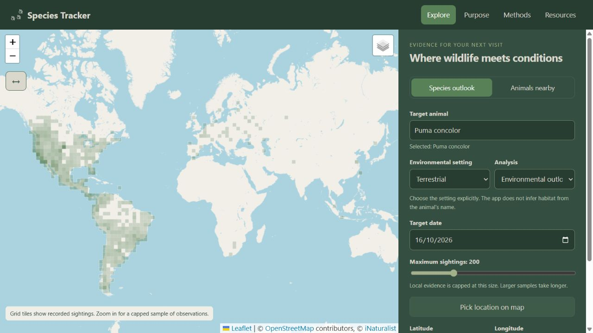
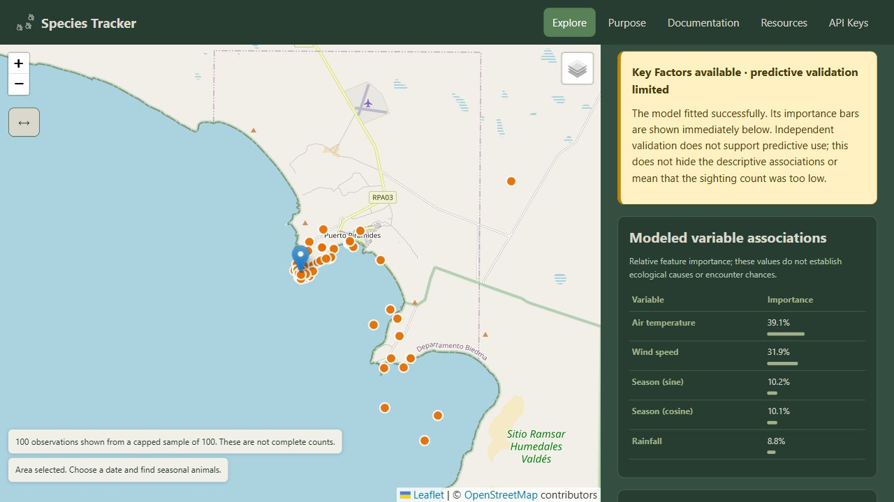
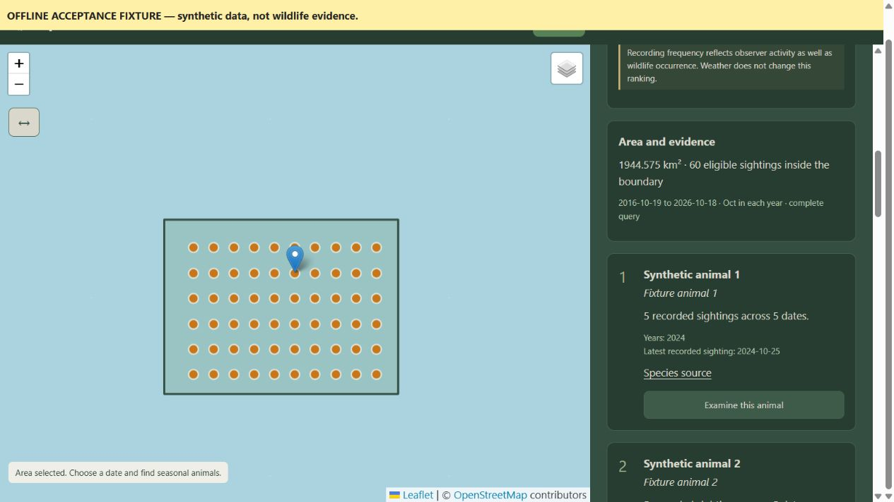

# Species Tracker

**Plan a wildlife visit with evidence.**

Species Tracker connects a place and a date with recorded wildlife sightings and environmental conditions. Discover animals recorded in an area, examine conditions for a selected species, and compare supported upcoming days—all from an interactive map.

It is a focused portfolio project combining geographic analysis, public data ingestion, statistical modeling, and a web interface. Its purpose is to help you decide **what to look for, where to investigate, and when conditions look relatively favorable**.



*Current desktop interface. The orange grid shows recorded observations; it is not an animal-density or encounter-probability map.*

> Results describe historical recording frequency and relative modeled conditions. They are **not calibrated probabilities of seeing an animal**.

[Run locally](#run-locally) · [How the analyses work](#how-the-analyses-work) · [Examples](#examples) · [Evidence and limitations](#evidence-and-limitations) · [Development](#development) · [Sources and credits](#sources-and-credits)

## What can I do with it?

| Your question | App workflow | What you get |
| --- | --- | --- |
| What animals could I look for here? | **Animals nearby** | Up to ten species ranked by historical sightings inside a polygon during the selected date ±3 days. |
| How do conditions look for one animal? | **Species outlook** | A historical sightings profile, an environmental outlook, or Random Forest variable importance. |
| Which upcoming day looks most favorable? | **When should I go?** | A comparison of supported days using the same local model, when validation supports ranking. |

Search by common or scientific name, select an explicit Terrestrial or Marine setting, and inspect the evidence behind each result. The browser remembers your last species and environmental setting and can resume an active task after refresh in the same tab.

The map uses overview tiles when zoomed out and a capped sample of individual observations when zoomed in. Loading and updating indicators explain what is happening; previous points or the grid remain visible while a new view loads. Photos load when you open a point, with contributor credits and license information. Slow or failed requests offer Retry.

## Run locally

Open a terminal in the **project root**, the folder containing this README. Choose either Python or Docker; both serve the app at **[http://127.0.0.1:8000/](http://127.0.0.1:8000/)** and use the same port.

**No API key is required to explore sightings or run the statistical analyses.** Gemini explanations are optional. There is no database to configure and no frontend build step.

### Option 1: Python on Windows

You need **Python 3.12**. Check with `python --version`, then run these commands in PowerShell:

```powershell
python -m venv .venv
.\.venv\Scripts\python.exe -m pip install -r backend/requirements-lock.txt
.\.venv\Scripts\python.exe -m uvicorn main:app --app-dir backend --host 127.0.0.1 --port 8000
```

Open the address above once the terminal reports that Uvicorn is running. Keep that terminal open while using the app; press **Ctrl+C** to stop it.

**Already installed?** Next time, run only:

```powershell
.\.venv\Scripts\python.exe -m uvicorn main:app --app-dir backend --host 127.0.0.1 --port 8000
```

These are the Python commands used for local verification on Windows; calling the virtual environment directly avoids activation and PowerShell execution-policy setup.

<details>
<summary>Equivalent commands for macOS/Linux</summary>

Use a Python 3.12 interpreter as `python3`:

```sh
python3 -m venv .venv
.venv/bin/python -m pip install -r backend/requirements-lock.txt
.venv/bin/python -m uvicorn main:app --app-dir backend --host 127.0.0.1 --port 8000
```

The direct macOS/Linux commands are provided as equivalents. The Linux/Python 3.12 container was tested separately; see the verification record below.

</details>

### Option 2: Docker

Start Docker Desktop/Engine first. Use a current Docker Compose version supporting optional `env_file` entries.

```sh
docker compose up --build -d
```

Open **[http://127.0.0.1:8000/](http://127.0.0.1:8000/)**. To stop the app later:

```sh
docker compose down
```

The image builds without a real `.env` file and runs as a non-root user. If a root `.env` exists, Compose supplies its values at runtime. Python startup, Docker build/startup, and browser workflows have been exercised locally; [validation.md](docs/validation.md) records the dates and limitations.

### Optional AI explanations

The statistical methods work independently of AI. To add Gemini explanations, use either of these options:

- **Personal key:** open **API Keys**, paste a Gemini key, and select **Apply key & rerun last analysis**. It reruns your last submitted species analysis with the same settings. With no previous analysis, apply the key first, then run one in Explore. No server restart is needed.
- **Server default:** for first-time setup, copy `.env.example` to a root `.env` and fill in `GEMINI_KEY`. If `.env` already exists, edit it rather than replacing it. Restart the Python server, or recreate the Compose container with `docker compose up -d --force-recreate`.

A personal key stays only in the page's memory and is cleared on refresh or when the tab closes. It is sent to the app backend and used with Google for that job; it is not written to `.env`, browser storage, or model caches. Your Google project's quota/charges apply. AI failure keeps the statistical result and a deterministic explanation available.

### If something does not start

| Symptom | What to check |
| --- | --- |
| Port 8000 is already in use | Stop the existing Python server or Compose service before starting another copy. |
| `No module named uvicorn` | Install the pinned requirements using the same `.venv` interpreter as the run command. |
| Docker cannot connect | Start Docker Desktop/Engine before running Compose. |
| The page still looks old | Reload with **Ctrl+F5** to refresh cached frontend assets. |
| Sightings/weather are unavailable | Check the result's source error. External maintenance and request limits can prevent an analysis; a missing result does not mean animals are absent. |

## How the analyses work

Two methods summarize observations. Two fit statistical models. The day comparison reuses an existing model rather than introducing another one.

**Historical Profile is the default.** The menu then offers Key Factors (advanced) and Environmental Outlook (advanced). The selected method explains its data policy and fitting/validation requirements before you run it. These requirements come from the server; this is not a separate availability check.

You can run the methods consecutively without refreshing. Each request replaces the previous result with a named progress panel and retains its submitted species, environment, and date. If an environmental method cannot be produced, the result explicitly says **Environmental Outlook unavailable** or **Key Factors unavailable**, explains the data limits, and labels any monthly chart as supporting historical evidence.

| Method | Main purpose | Fits an environmental model? |
| --- | --- | --- |
| Historical Profile | Explore when sightings were recorded. | No |
| Key Factors (advanced) | Examine which predictors help distinguish sighting/background conditions. | Yes—Random Forest |
| Environmental Outlook (advanced) | Compare forecast conditions with local sighting/background conditions. | Yes—logistic regression |
| Animals Nearby | Find the most recorded species in an area during a season. | No |
| When should I go? | Compare eligible upcoming days. | Reuses the logistic model |

The result's **Evidence checklist** shows retrieved sightings, generated comparison backgrounds, usable counts, total usable records, and grouped exclusions beside the fitting minimums. Sightings are recorded observations; backgrounds are generated locations/dates, not confirmed absences. Unknown final retention is labeled **Not evaluated**, including when imputation stops early.

Only the usable sighting/background/total counts have fitting minimums. Retrieved and excluded counts are accounting information. Meeting the minimums is necessary for fitting, but environmental eligibility must also pass. A yellow notice distinguishes **insufficient usable evidence** (no model fitted) from **limited predictive validation** (a model fitted, but predictive use is unsupported). Key Factors still shows descriptive importance in the latter case. Importance bars and forecast conditions appear before diagnostic tables so the available result is easy to find. The Evidence explanation has a sparkle icon and explicitly identifies an AI summary or a deterministic evidence summary.

Fitted models have separate **Spatial validation** and **Chronological validation** cards. They show three-decimal AUC and balanced accuracy for the environmental model and seasonality-only baseline, training/test counts, actual spatial-cell/date coverage, and specific reasons when a holdout cannot run. The verdict uses the recorded metric precision. An available holdout stays visible even when the other is unavailable. Missing metrics are not replaced with zeros, and meeting count minimums does not guarantee independent validation or a favorable forecast. No significance test is performed; unsupported AI significance claims fall back to the deterministic explanation.

### Historical Profile: recorded seasonality

Counts retrieved sightings for each calendar month across the available years and lists the years represented. There is no classifier and no weather model.

**Example:** 40 July records and 10 January records mean more July sightings were recorded in this sample. They do not establish that four times as many animals were present or that a July visit is four times more likely to succeed. Observer activity and the local sample cap affect the counts.

### Environmental Outlook: logistic regression

The model compares **sightings** with generated **background samples** inside the same study circle. Backgrounds represent available conditions; they are not confirmed animal absences.

Logistic regression learns an additive relationship between environmental predictors, seasonality, and the sighting/background labels. Predictors are standardized using training statistics. Regularization discourages excessively large coefficients to reduce overfitting.

Its 0–1 score describes this constructed classification task, not encounter probability. When validation permits an assessment, the app compares the forecast score with the final training sample's lower and upper quartiles to describe conditions as **less favorable**, **typical**, or **more favorable**.

Incomplete historical records are excluded for this method. Missing forecasts or conditions outside the observed training ranges withhold a reliable favorability assessment. Dates outside the supported forecast window show the historical profile with weather unavailable.

### Key Factors: Random Forest

A forest combines **200 decision trees**. Each tree makes a sequence of threshold decisions; together they can capture nonlinear patterns and interactions that the additive logistic model does not explicitly represent.

The importance bars show how much each predictor's splits reduce class impurity across the forest. **A 30% importance bar is not a 30% encounter chance.** Importance does not reveal the direction of an effect or prove causation, and correlated predictors can share or obscure importance.

Random Forest retains eligible incomplete historical records through **proximity imputation**:

1. Initialize missing cells with training medians.
2. Fit a forest and measure how often pairs of records reach the same terminal leaf.
3. Estimate missing values using proximity-weighted means of originally observed donor values.
4. Repeat for five iterations, preserving measured values throughout.

Imputation is fitted separately inside each validation split. Held-out records use only training donors, without their labels or other held-out records influencing the estimates. Records without supported donors are excluded; median initialization is never silently accepted as the final fallback.

The result distinguishes complete, imputed, and excluded records. This method describes historical associations; it does not forecast your selected day's encounter.



*Offline acceptance example: 205 complete records and 35 retained through imputation. These are artificial test records, not evidence about a real species.*

<details>
<summary>Model settings and imputation safeguards</summary>

- Logistic regression: standardized predictors, L2 regularization with `C=1`, and up to 1,000 optimizer iterations.
- Random Forest: 200 trees, maximum depth 8, minimum leaf size 3, seed 42.
- Models require at least 40 usable records overall, including 15 sightings and 15 backgrounds; validation splits have additional sample/class requirements.
- Random Forest excludes invalid locations/dates, known unsupported dates, and records missing more than half their environmental predictors. Marine records need at least one observed marine predictor.
- Each imputation training predictor needs 15 original observed donors, two distinct values, and at most 50% missingness. Unresolved rows are removed; at most five restarts are allowed before reporting insufficient evidence. Processing is capped at 1,000 sighting/background records.
- No coefficient p-values, confidence intervals, or encounter-probability calibration are produced. The app's **Documentation** tab explains formulas, validation splits, and limitations in more detail.

</details>

### Animals Nearby: seasonal Top 10

Fetches eligible wild-animal observations for a **seven-day window centered on the selected date**: three days before, the selected date, and three days after. For **20 October**, this is **17–23 October**, inclusive. It matches those seven month/day dates over the preceding ten years, ending yesterday. The controls and results show the exact interval, including month/year crossings.

It filters the polygon exactly, includes boundary points, combines subspecies under species, and ranks by observation count, distinct observation dates, then taxon ID. Cross-month windows query each month's matching days separately and share one 5,000-record cap; incomplete queries never produce a partial ranking. February 29 contributes only in historical leap years when it belongs to the selected seven calendar dates. A narrower window can have fewer recorded species than the former monthly query.

**Example:** 20 October uses historical records from 17–23 October; 21 October uses 18–24 October, so the ranking can change. Weather for the selected central day is shown separately and does not change the ranking.

This is not ten environmental models. If fewer species have evidence, fewer than ten appear. Queries exceeding the configurable 5,000-record bounding-box cap—or interrupted pagination—fail explicitly rather than showing an incomplete ranking as complete.



*Offline acceptance example from the earlier interface; current discovery uses the selected date ±3 days. The polygon, species names, and sightings are test fixtures; they demonstrate the workflow rather than a real animal distribution.*

### When should I go?: compare supported days

Choose a resolved species, environmental setting, and study location, then click **When should I go? · next seven days**. The action is always visible in the species controls and becomes enabled when those inputs are ready; no previous analysis is required. Apply edited coordinates with **Use these coordinates** before comparing. It runs Environmental Outlook directly, fitting one local logistic model or reusing a matching cached model across the next seven days starting today. Species, study circle, model, and environmental setting stay fixed within the comparison.

A ranking requires both validation checks to beat the seasonal baseline, at least two complete days inside the environmental training ranges, and differing scores. Unsupported days are excluded. Otherwise, the app shows conditions and explains why a reliable ranking is unavailable.

“Saturday has the most favorable modeled conditions” means it ranks highest **among those eligible days**, not that differences are statistically significant or sightings are guaranteed.

### Terrestrial and Marine are different settings

| Setting | Environmental predictors |
| --- | --- |
| **Terrestrial** | Air temperature (°C), wind speed (km/h), precipitation (mm/day). |
| **Marine** | Sea surface temperature (°C), wind speed (km/h), wave height (m), ocean current velocity (km/h). |

Both include month sine/cosine features, keeping December adjacent to January. Environmental values use daily UTC means, except precipitation, which is a daily total. A daily value requires all 24 valid hourly measurements.

**The setting changes the data and predictors used to fit the model.** It does not infer habitat from the species name, filter observations into land/sea habitats, or change Historical Profile counts or Animals Nearby rankings. Choose the environment you want to study explicitly.

### How do we check whether a model is useful?

- **Spatial holdout:** evaluate on geographic cells withheld from training. Records in the same 0.1-degree latitude/longitude cell stay together across dates; physical cell width varies with latitude.
- **Chronological holdout:** train on earlier dates and evaluate on later dates, keeping same-date records together.
- **Seasonal baseline:** compare both models with a logistic classifier using only cyclic month features on the same retained records.

| Diagnostic | Meaning |
| --- | --- |
| **ROC AUC** | How well scores order sightings above backgrounds. Around 0.5 is chance-level ordering. |
| **Balanced accuracy** | The average recall of the two classes, using a score threshold of 0.5. It gives both classes equal weight. |

For an environmental assessment or day ranking, each holdout must have higher AUC than the seasonal baseline and balanced accuracy at least as high. If either holdout cannot be evaluated, the result is marked experimental. These are classifier diagnostics on single holdouts, not field-visit success rates or statistical significance tests.

## Examples

Try these public study locations after starting the app. Select the resolved autocomplete result, choose the setting, enter the coordinates, and use today's date. Start with Historical Profile to inspect recorded evidence, then try Environmental Outlook or Key Factors.

| Example | Species | Setting | Latitude | Longitude |
| --- | --- | --- | ---: | ---: |
| San Juan / southern Salish Sea region | *Orcinus orca* | Marine | 48.5 | -123.1 |
| San Francisco Peninsula region | *Puma concolor* | Terrestrial | 37.4 | -122.2 |

Use a sample cap of 100 for the walkthrough. The study radius starts at 5 km and can expand to 50 km. A result reporting insufficient evidence or withholding a ranking is a valid outcome.

**Live validation status:** the saved 2026-10-16 walkthrough attempts were blocked by iNaturalist maintenance. They contain no real ecological validation scores. Successful screenshots and masked-data experiments are explicitly synthetic where applicable; do not interpret them as validated orca or puma predictions.

For reproducible demonstrations without sightings/weather API calls:

```powershell
.\.venv\Scripts\python.exe scripts/browser_fixture_server.py --ack-synthetic
```

Open **[http://127.0.0.1:8002/fixture](http://127.0.0.1:8002/fixture)**. Search `Fixture`, select the result, enter `0.4, 0.4`, and run an analysis. For discovery, draw around the visible fixture observations. The page prominently labels its synthetic data. This is a test server, not an offline biodiversity database; map tiles and frontend CDN assets still need internet access.

See [portfolio walkthroughs](docs/portfolio-cases.md) for live/synthetic reproduction commands and [validation evidence](docs/validation.md) for the masked-data comparison against median filling. The saved synthetic experiment had lower reconstruction error with proximity imputation; this does not guarantee improvement on real or differently missing data.

## Evidence and limitations

- Observations come from iNaturalist: research-grade, georeferenced, non-captive records for analysis/discovery. Recording frequency reflects observer effort, accessibility, and identification as well as wildlife occurrence.
- Species analyses use a capped local sample: 200 sightings by default, adjustable from 100 to 500. Historical monthly counts may therefore be incomplete. The zoomed-in map is also a disclosed capped sample, not a complete survey.
- Marine SST/current history is requested only from January 2022 onward. Archived weather has a five-day publication guard; coastal coverage and data resolution can limit interpretation.
- Background samples are not absences. Proximity estimates are not measurements. Imputation, grouping, and validation do not eliminate sampling bias or spatial dependence.
- Geometry, source dates/IDs, missingness, exclusions, model version, and diagnostics are exposed with the results. Expand the technical evidence to inspect them.
- Jobs run in server memory: two active, eight queued, with completed results retained for 24 hours. A server restart removes tasks; the UI explains when a request must be rerun.

The project stays focused on wildlife visit planning: no accounts, tracking telemetry, or additional biodiversity-platform integrations are required for these workflows.

## Development

**Python 3.12 · FastAPI · Leaflet · scikit-learn · Shapely/PyProj · optional Google Gen AI SDK**

The frontend is plain JavaScript; the backend validates requests, retrieves public data, and runs bounded background jobs. Model fitting and AI work are offloaded from the event loop. Requests share timeouts, bounded concurrency, retries, and upstream budgets.

The maintained suite is intentionally limited to **three test files**: API validation/task handling, core analysis/discovery behavior, and Random Forest proximity imputation. Frontend modules have syntax checks. See [dated validation evidence](docs/validation.md) for current and historical verification results; the Docker build/startup record is from the earlier portfolio release.

- [Development and API reference](docs/development.md): architecture, configuration, endpoints, tests, and deployment notes.
- [Portfolio walkthroughs](docs/portfolio-cases.md): reproduce marine, terrestrial, and synthetic cases.
- [Validation evidence](docs/validation.md): test runs, source limitations, and measured imputation results.
- [Pinned Python dependencies](backend/requirements-lock.txt) and [GitLab CI](.gitlab-ci.yml).

## Sources and credits

Species Tracker builds on the work of data contributors, designers, and open-source maintainers. The original image credits and resource links are preserved below, including assets and references retained from earlier versions. Third-party material remains subject to its own license; these acknowledgments do not relicense it.

### Icons and retained image assets

These are the original creator credits and Flaticon URLs recorded in the project history. All six icon files remain in the repository, including icons no longer displayed by the current interface.

| Image file | Original attribution and source | Use |
| --- | --- | --- |
| [Area selector](resources/images/area_selector_icon.png) | [Polygonal icons created by Voysla - Flaticon](https://www.flaticon.com/free-icons/polygonal) | Retained area-selection icon. |
| [Ruler](resources/images/ruler_icon.png) | [Ruler icons created by Freepik - Flaticon](https://www.flaticon.com/free-icons/ruler) | Retained measuring-tool icon. |
| [Animal tracks](resources/images/track_icon.png) | [Dog icons created by Made by Made - Flaticon](https://www.flaticon.com/free-icons/dog) | Current application branding and favicon; the header applies a color filter. |
| [Purpose target](resources/images/target_icon.png) | [Objectives icons created by sonnycandra - Flaticon](https://www.flaticon.com/free-icons/objectives) | Retained Purpose-tab icon. |
| [Open book](resources/images/open-book_icon.png) | [Book icons created by Roundicons Premium - Flaticon](https://www.flaticon.com/free-icons/book) | Retained Documentation-tab icon. |
| [Resources box](resources/images/box_icon.png) | [Box icons created by Pixel perfect - Flaticon](https://www.flaticon.com/free-icons/box) | Retained Resources-tab icon. |

The original links are category pages, rather than individual download pages. Asset-specific download certificates and license records are not included in the repository, so the applicable license for each download still needs to be retained or recovered. Flaticon's [free-license guidance](https://www.flaticon.com/media/license/license.pdf) requires attribution and restricts redistribution; credit alone does not establish permission to redistribute the image files. Refer to the applicable download license and [Flaticon terms](https://www.flaticon.com/terms-of-use).

The retained [selected-area reference image](resources/images/selected_area_example.png) comes from [Allen Coral Atlas](https://www.allencoralatlas.org/atlas/#1.00/0.0000/-145.0000), powered by Arizona State University, and visibly credits **Planet Dove Imagery & Research Partners**. It is an external reference, not a Species Tracker screenshot, and is not used in the current interface or the examples above. The original source URL has been restored; a screenshot-specific license or reuse permission is not recorded in the repository and remains unverified.

### Wildlife, environmental data, and maps

| Source | Contribution and attribution |
| --- | --- |
| [iNaturalist API v1](https://api.inaturalist.org/v1/docs/) and [v2](https://api.inaturalist.org/v2/docs/) | Wildlife observations, taxonomy, and observation grid tiles, contributed by the iNaturalist community. Source observation links identify the underlying records. |
| [Open-Meteo Weather](https://open-meteo.com/en/docs), [Historical Weather](https://open-meteo.com/en/docs/historical-weather-api), and [Marine](https://open-meteo.com/en/docs/marine-weather-api) | Weather data by [Open-Meteo.com](https://open-meteo.com/), with upstream weather-service credits listed on its [data sources and license page](https://open-meteo.com/en/licence). Species Tracker aggregates hourly values into daily predictors and derives statistical outputs from them. |
| [OpenStreetMap](https://www.openstreetmap.org/) | Light basemap: © [OpenStreetMap contributors](https://www.openstreetmap.org/copyright). |
| [Esri World Imagery](https://www.arcgis.com/home/item.html?id=10df2279f9684e4a9f6a7f08febac2a9) | Satellite basemap supplied by Esri and its imagery contributors. Consult the source item's credits and terms for the imagery being used. |
| [Leaflet](https://leafletjs.com/) | Interactive map, layers, controls, and drawing interactions. |

Observation photographs belong to their contributors. The interface retains supplied attribution and license information, with links back to the observation. Licenses vary per image; consult the original observation and [iNaturalist's media-use guidance](https://help.inaturalist.org/en/support/solutions/articles/151000169918) before copying or republishing a photograph.

Open-Meteo API data are offered under [CC BY 4.0](https://creativecommons.org/licenses/by/4.0/); API access is also subject to separate [service terms](https://open-meteo.com/en/terms). Preserve data and map credits when sharing results or screenshots.

The [desktop](docs/screenshots/desktop.jpg), [discovery](docs/screenshots/discovery.jpg), and [Random Forest](docs/screenshots/random-forest.jpg) images above capture Species Tracker's interface. The latter two use explicitly labeled synthetic fixture evidence. Map imagery remains third-party material, and the screenshots retain visible map credits.

### Software and statistical references

The application uses these projects; their own licenses and notices apply:

- **Web backend:** [FastAPI](https://fastapi.tiangolo.com/), [Pydantic](https://docs.pydantic.dev/), [Uvicorn](https://www.uvicorn.org/), [HTTPX](https://www.python-httpx.org/), [cachetools](https://pypi.org/project/cachetools/), and [python-dotenv](https://github.com/theskumar/python-dotenv).
- **Numerical and statistical analysis:** [NumPy](https://numpy.org/), [Pandas](https://pandas.pydata.org/), [scikit-learn](https://scikit-learn.org/), and [SciPy](https://scipy.org/) (a numerical dependency of scikit-learn).
- **Geometry and distance calculations:** [Shapely](https://shapely.readthedocs.io/) and [PyProj](https://pyproj4.github.io/pyproj/).
- **Optional AI interpretation:** [Google Gen AI SDK](https://googleapis.github.io/python-genai/).
- **Verification:** [pytest](https://docs.pytest.org/) and [Node.js syntax checks](https://nodejs.org/api/cli.html#-c---check).

Statistical references: [scikit-learn logistic regression](https://scikit-learn.org/stable/modules/linear_model.html#logistic-regression), [Random Forest importance](https://scikit-learn.org/stable/modules/ensemble.html#feature-importance-evaluation), and [randomForest proximity imputation](https://search.r-project.org/CRAN/refmans/randomForest/html/rfImpute.html). Our held-out imputation uses an explicit training-only transformation, not the R package itself.

### Earlier resources and acknowledgments

These links acknowledge resources used or considered during development. They are preserved for provenance and are not a list of current integrations:

| Resource | Historical role |
| --- | --- |
| [OBIS API](https://api.obis.org/v3/) | Earlier marine-occurrence integration; the current release uses iNaturalist for sightings. |
| [CARTO basemaps](https://carto.com/basemaps/) | Earlier basemap provider. Current layers use OpenStreetMap and Esri. |
| [Inter by Rasmus Andersson](https://fonts.google.com/specimen/Inter) | Earlier interface typeface reference. The current interface uses system fonts. |
| [Turf.js](https://turfjs.org/) | Earlier browser geometry tooling. Current geometry validation uses Shapely/PyProj on the server. |
| [Statsmodels](https://www.statsmodels.org/) | Earlier statistical tooling/reference; not used by the current methods. |
| [Movebank API documentation](https://github.com/movebank/movebank-api-doc/blob/master/movebank-api.md) | Previously considered future data source; no Movebank integration is included. |

The in-app Resources tab provides additional links to current tools and documentation. Acknowledgment of a source does not imply its endorsement of Species Tracker.
